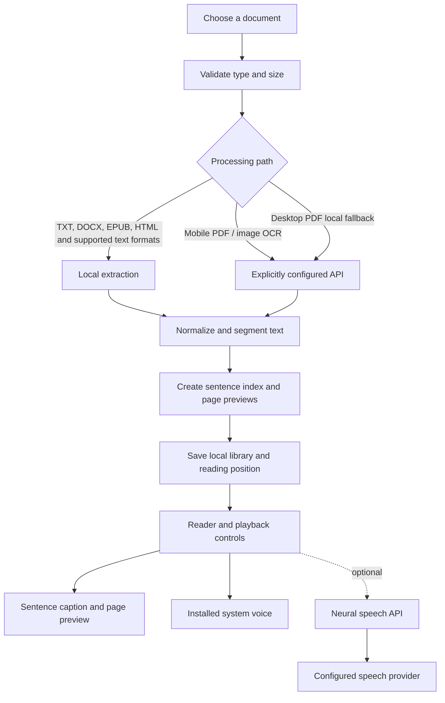
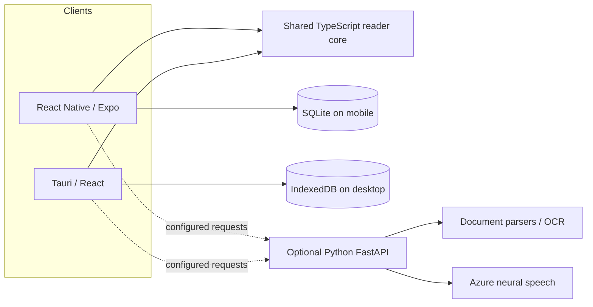

# ReadAloud

**A local-first reading and listening companion for long-form documents.**

ReadAloud combines a personal library, document indexing, page-style previews, sentence-synchronised captions and playback controls. It is designed for readers who want to listen to books, reports and documents while keeping their library on their own device by default.

> **Release status: pre-release.** The source is under active development. No desktop installer, Android package or iOS build has been certified by this repository as a production release. Build, signing, real-device, store-policy and legal checks in [the release checklist](docs/RELEASE_CHECKLIST.md) are release gates—not claims that those checks have passed.

## Product targets and current boundaries

| Target | Implementation | Important boundary |
| --- | --- | --- |
| Windows desktop | React + TypeScript, Vite and Tauri 2 | Windows NSIS installer is configured; clean-machine installation, signing, upgrade and uninstall still require verification. |
| Android | React Native + Expo | Minimum Android API 26 (Android 8.0). An install-size budget of 25 MB is a target to measure on a signed release artifact, not a verified result. |
| iOS | React Native + Expo | Configured deployment target iOS 16.4; build and submission require macOS/Xcode and Apple signing credentials. |
| Optional processing API | Python 3.11+ / FastAPI | Provides document extraction/OCR and Azure neural speech. It is optional and must be deployed with TLS, a strong token, trusted-host/CORS configuration, shared rate-limit storage and provider spend controls. |

The app does not currently implement user accounts, cross-device sync, cloud library backup, or advertising analytics. Device-installed system voices can work without the API. Neural voices require a configured API and Azure Speech credentials on the server. Voice availability and pronunciation vary by platform and provider.

## How it works





**Privacy boundary:** imported text and reading position are stored locally by default. The mobile app sends PDF/image files to the configured service when those formats need server extraction; neural voice sends the current sentence to the configured service. Only configure a service you trust. See [Security and privacy](docs/SECURITY.md).

## Repository map

- `apps/mobile` — Expo mobile client, SQLite library, document import and playback.
- `apps/desktop` — Tauri desktop client, IndexedDB library and local document processing.
- `apps/api` — optional FastAPI extraction/OCR and neural-speech service.
- `packages/reader-core` — shared types, format validation, text normalization, sentence segmentation, previews and playback-domain logic.
- `docs/ARCHITECTURE.md` — component boundaries and data flow.
- `docs/SECURITY.md` — trust boundaries and deployment security baseline.
- `docs/RELEASE_CHECKLIST.md` — measurable release gates for desktop, Android, iOS, API and stores.

## Development prerequisites

- Node.js 22.13+ and npm 10.9+.
- Rust and Tauri's Windows build prerequisites for the desktop installer.
- Android Studio/SDK for Android builds.
- macOS, Xcode and Apple signing credentials for iOS release builds.
- Python 3.11+ and Tesseract OCR for the optional API.
- Azure Speech resource credentials only if enabling neural speech.

## Common commands

Run from the repository root:

```sh
npm install
npm run test:core
npm run typecheck
npm run dev:desktop
npm run dev:mobile
npm run build:desktop
npm run build:android
npm run build:ios
```

The API's tests use pytest. From the repository root, create a Python virtual environment, install `apps/api/requirements.txt` and `apps/api/requirements-dev.txt`, then run:

```sh
python -m pytest apps/api/test
```

For a local API, copy `apps/api/.env.example` to `apps/api/.env`, configure local-only values, install Tesseract, then run:

```sh
uvicorn app.main:app --app-dir apps/api --host 127.0.0.1 --port 8787
```

Do not expose that development command to the public internet. Production requires HTTPS, a high-entropy `READALOUD_API_TOKEN`, exact `READALOUD_ALLOWED_HOSTS` and `READALOUD_CORS_ORIGINS`, protected shared Redis rate-limit storage, secret-manager-backed Azure credentials, ingress/request timeouts, monitoring and provider spend limits. A single shared bearer token is not a multi-user identity or account system.

## Supported import formats

Format support varies by platform and extraction path. Current code includes TXT, DOCX, EPUB, HTML/Markdown/RTF-style text and PDF/image extraction paths. Mobile PDF and image OCR require the optional API; desktop PDF attempts local extraction and can use the API fallback. Validate the actual sample corpus and error states per platform before advertising support in a store listing.

## Security, performance and release discipline

- Imported files are untrusted input. The shared core and API enforce file/format/archive/text limits; API document extraction is run outside the event loop, and neural audio is capped while streamed from the provider.
- The library list uses summary records and loads the selected book's full index on demand.
- Keep provider secrets on the server or in platform secure storage; never bake production service credentials into public client bundles.
- No CI workflows are included by project policy. Run the documented checks manually in a clean, supported environment and preserve the logs.
- The mobile 25 MB install-size target must be measured on the final signed artifacts for each platform. If it is exceeded, inspect bundle contents and native dependencies before release; do not claim compliance based on JavaScript source size.
- Read the release checklist. Any unchecked build, device, security, size, legal, signing or store item blocks a production launch.

## License and third-party notices

No repository license has been selected or published yet. Until the owner publishes an explicit license and required third-party notices, do not assume that this repository is open source or that redistribution is permitted. Review dependency licenses and add the owner's approved license before public distribution.
