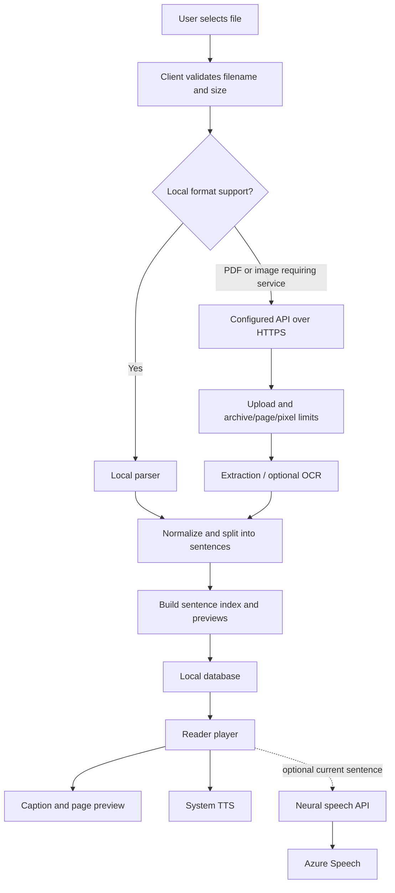

# ReadAloud architecture

## Runtime components

- **Mobile client:** React Native + Expo. SQLite stores library metadata and reading position; the selected book's full sentence/page index is loaded on demand. Device speech is the local fallback. Neural speech and mobile PDF/image OCR use an explicitly configured API.
- **Desktop client:** React + TypeScript + Vite in a Tauri 2 shell. IndexedDB stores compact book summaries separately from full book data. It performs supported extraction locally and can call the API for PDF/OCR fallback and neural speech.
- **Reader core:** platform-neutral TypeScript types, format/size validation, archive validation, text normalization, sentence segmentation, page previews and playback mapping.
- **Optional API:** FastAPI receives bounded document uploads, performs server-side extraction/OCR, and calls Azure Speech for a fixed set of neural voices. It does not provide accounts, cloud library storage or cross-device synchronization.

## Data flow

## Security boundaries and operational assumptions

1. Imported files are untrusted. Client checks improve usability; server-side validation is still required for every upload.
2. Local libraries remain on-device by default. Configure remote processing only when the user trusts the operator and provider.
3. Production API configuration must use HTTPS, exact trusted hosts and origins, a high-entropy token, shared Redis-backed rate limits, provider quotas and secret-manager-backed credentials.
4. A single bearer token is service access control for a trusted/self-hosted deployment, not a multi-user identity solution. Do not embed a production shared token in a distributed app.
5. Server extraction and OCR are CPU/memory intensive. Concurrency, request limits, provider latency, deployment memory and disk usage must be measured under realistic load.
6. Desktop CSP and Tauri capabilities must remain narrow. Mobile signing, OS background audio, data migration and install-size behavior can only be accepted from real artifacts on target OS versions.

## Storage and performance

- Mobile library lists use summary metadata in SQLite; full book content is fetched only when a book is opened.
- Desktop stores summary records separately from full content in IndexedDB and loads full data on demand.
- Sentence indexes and page previews trade local storage for fast seeking and synchronized captions. Validate large-book memory and storage behavior on the lowest supported devices.
- Temporary neural audio is cache data, not a permanent library asset. Verify cleanup after normal completion, stop, switching books, provider failure and app lifecycle changes.

## Non-goals in the current source

User accounts, cloud sync, server-side library storage, cloud backup, advertising analytics and a public multi-tenant API identity model are not implemented. Do not imply otherwise in marketing or store metadata.
